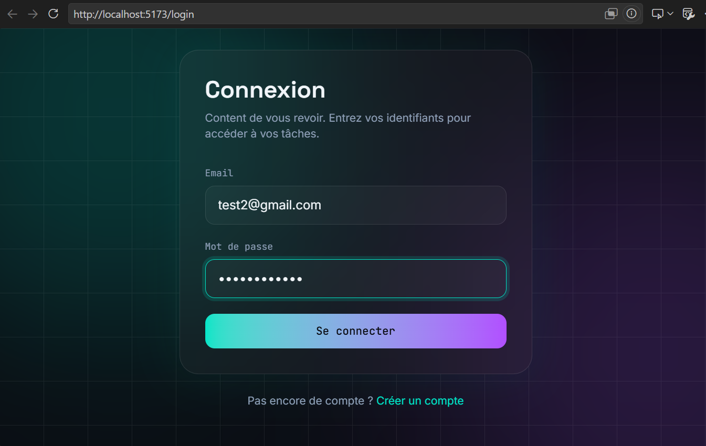
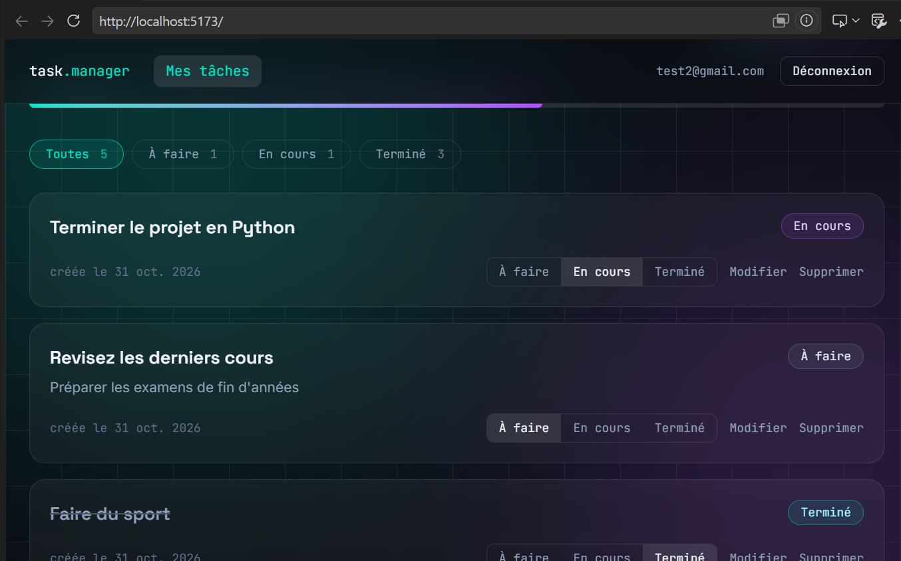
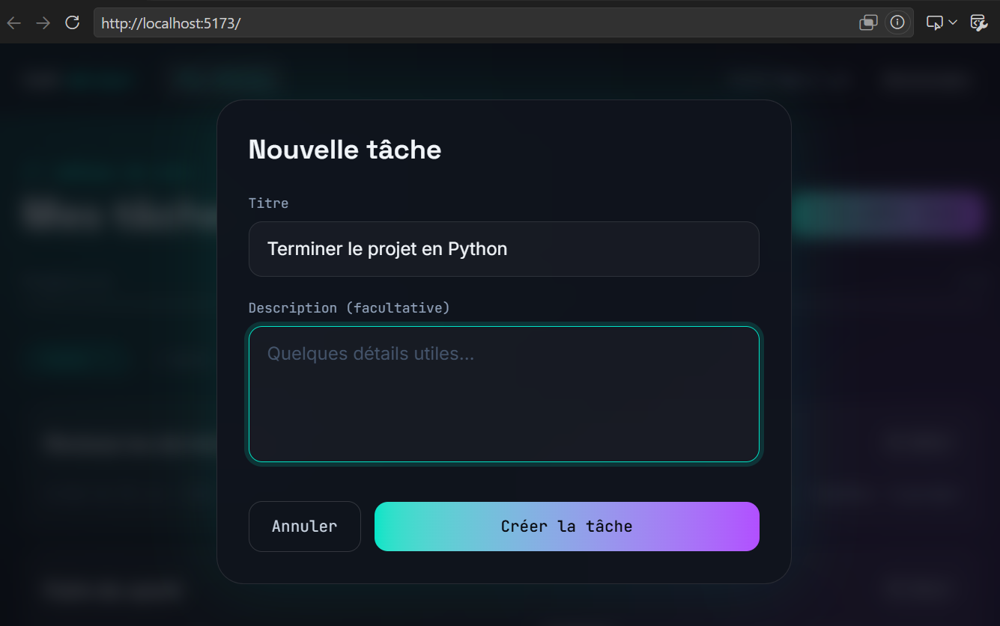

# Task Manager UI

Interface web pour gérer ses tâches, construite avec React et branchée sur l'API [Task API Secure](https://github.com/W1LL1VMS/task-api-secure). Connexion et inscription, liste des tâches avec filtres et progression, création, modification, suppression, et une vue réservée aux administrateurs.

## Fonctionnalités

- Inscription et connexion, avec validation des formulaires côté navigateur
- Session conservée après un rechargement de page
- Liste des tâches de l'utilisateur, filtrable par statut, avec compteurs et barre de progression
- Création et modification dans une fenêtre modale, changement de statut en un clic
- Suppression avec confirmation
- Page d'administration en lecture seule, visible uniquement pour le rôle administrateur
- Interface sombre et animée, adaptée aux petits écrans

## Stack technique

React avec Vite, React Router pour la navigation, Axios pour les appels à l'API, React Hook Form et Zod pour les formulaires, Tailwind CSS pour le style.

## Comment l'authentification fonctionne

L'application ne stocke jamais de jeton dans le navigateur de façon persistante.

- Le jeton d'accès, qui dure 15 minutes, reste uniquement en mémoire dans l'application. Il disparaît à la fermeture de l'onglet.
- Le jeton de renouvellement est envoyé par l'API dans un cookie HttpOnly. Le JavaScript de la page ne peut pas le lire, même si une faille XSS existait un jour.
- Au chargement de la page, l'application demande à l'API un nouveau jeton d'accès grâce à ce cookie : c'est ce qui conserve la session après un rechargement.
- Quand une requête reçoit une erreur 401, le client Axios renouvelle la session une seule fois, même si plusieurs requêtes échouent en même temps, puis rejoue la requête. Si le renouvellement échoue, l'utilisateur est renvoyé vers la page de connexion.

Les titres et descriptions de tâches sont toujours affichés comme du texte, jamais comme du HTML. La protection de la page d'administration côté interface ne sert qu'à l'affichage : c'est l'API qui refuse réellement l'accès aux non-administrateurs.

## Installation

Ce projet a besoin de l'API pour fonctionner. Lance d'abord [Task API Secure](https://github.com/W1LL1VMS/task-api-secure) en suivant son README (base PostgreSQL, fichier .env, `npm run dev`). Elle écoute sur le port 3000.

Ensuite, pour l'interface :

\`\`\`bash
git clone https://github.com/W1LL1VMS/task-manager-ui.git
cd task-manager-ui
npm install
\`\`\`

Copie `.env.example` vers `.env`. La valeur par défaut convient si l'API tourne en local :

\`\`\`
VITE_API_URL="http://localhost:3000"
\`\`\`

Les variables préfixées par `VITE_` sont visibles dans le code envoyé au navigateur : n'y mets jamais de secret.

Lance l'application :

\`\`\`bash
npm run dev
\`\`\`

Elle est disponible sur `http://localhost:5173`. Cette adresse correspond à celle autorisée par défaut dans la configuration CORS de l'API.

Pour tester la page d'administration, passe le champ `role` d'un utilisateur à `ADMIN` dans la table `users` (par exemple avec `npx prisma studio` dans le dossier de l'API), puis recharge la page.

## Structure du projet

\`\`\`
src/
├── api/          client Axios, appels à l'API, messages d'erreur
├── components/   composants réutilisables (carte de tâche, fenêtre modale, routes protégées)
├── context/      état d'authentification
├── hooks/        chargement et modification de la liste de tâches
├── lib/          constantes (statuts)
└── pages/        connexion, inscription, tableau de bord, administration
\`\`\`

## Captures d'écran

## Limites actuelles

Pas de tests automatisés sur l'interface. L'application n'est pas encore déployée : elle suppose une API lancée en local. La liste des tâches n'est pas paginée, ce qui conviendrait mal à plusieurs centaines de tâches par utilisateur.

## Améliorations prévues

- Tests des composants et du flux de connexion
- Déploiement de l'API et de l'interface
- Pagination et recherche dans les tâches
- Mises à jour optimistes pour que les changements de statut soient instantanés

## Licence

MIT, voir [LICENSE](LICENSE).

## Auteur

Williams, étudiant en Master 2 Informatique à AGITEL Formation, Abidjan.